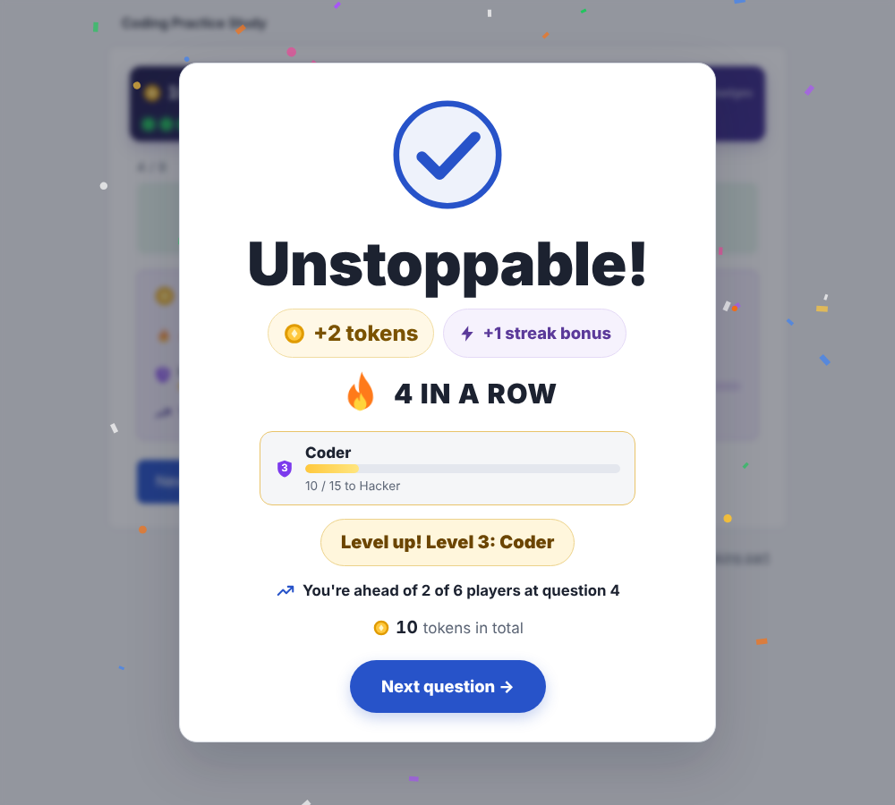
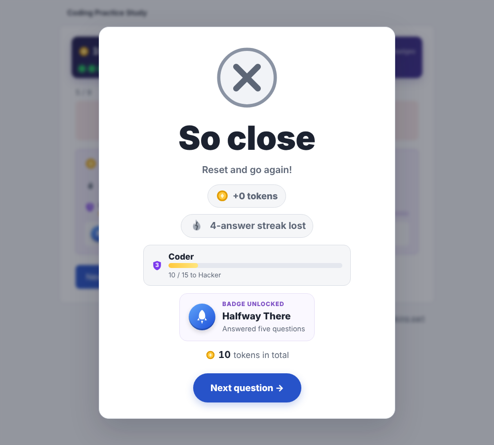
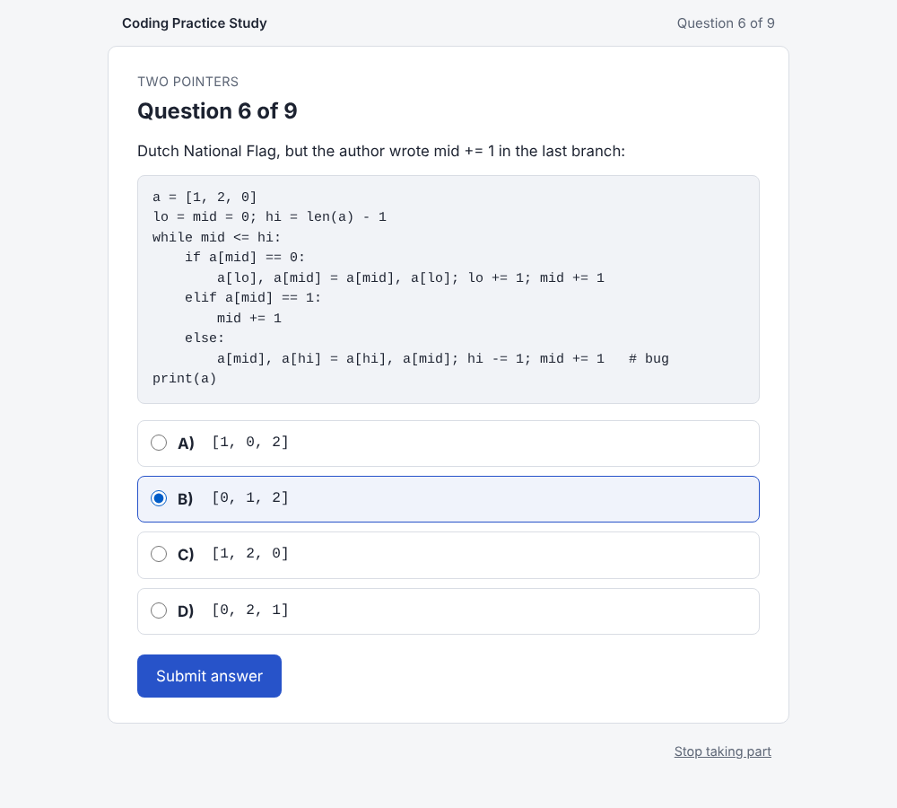
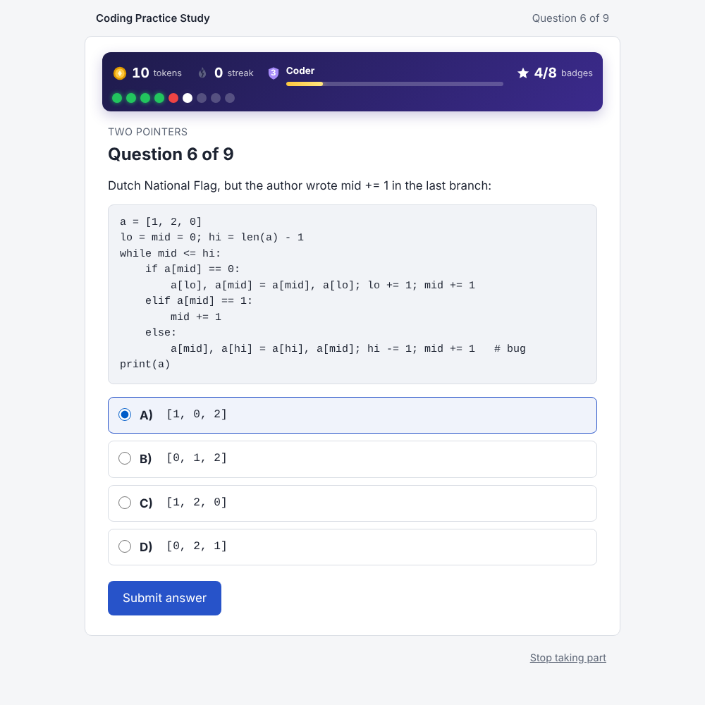
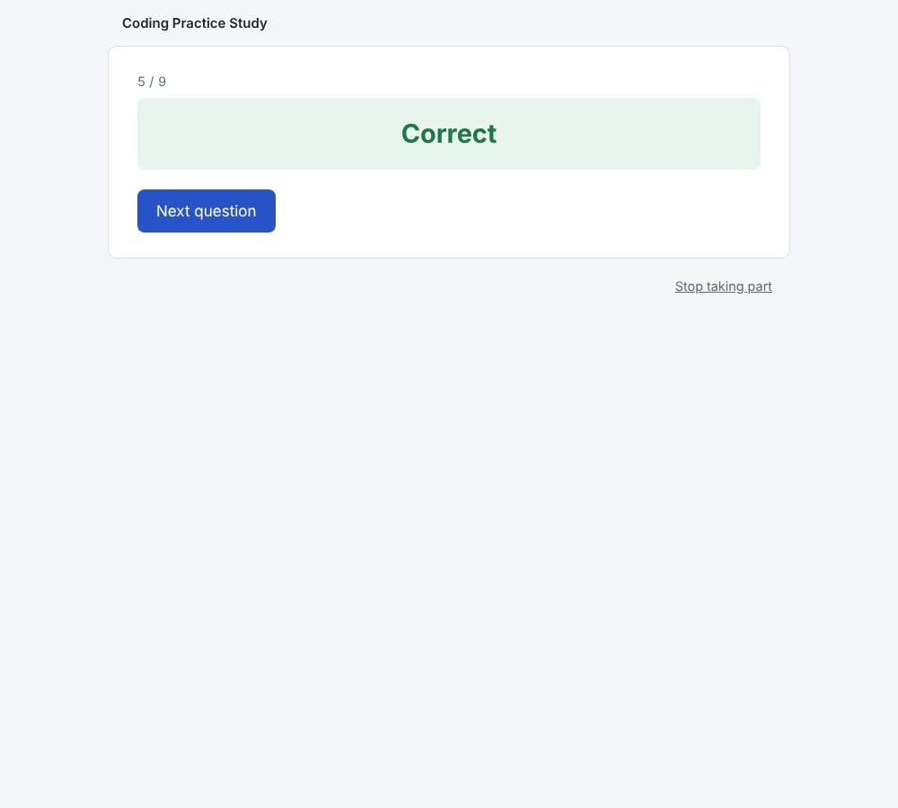
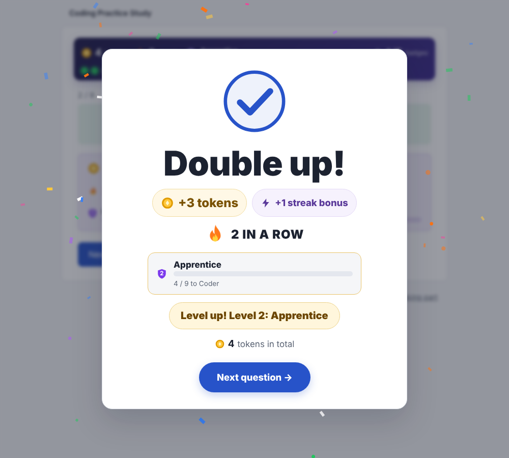
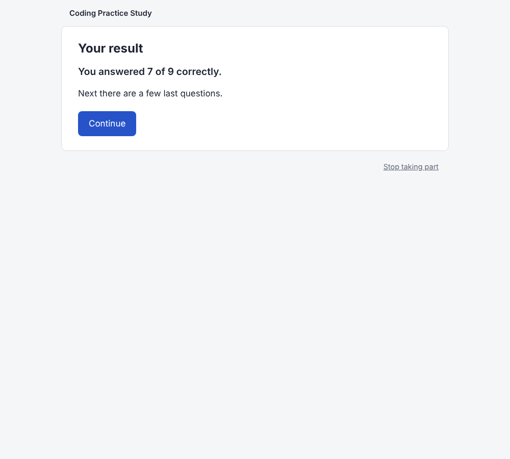
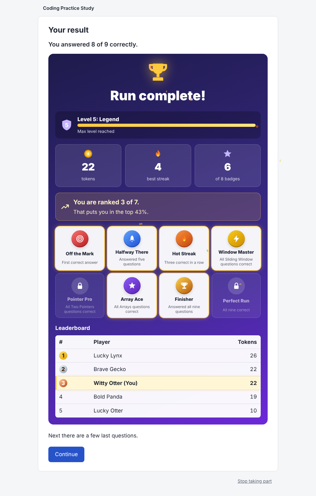
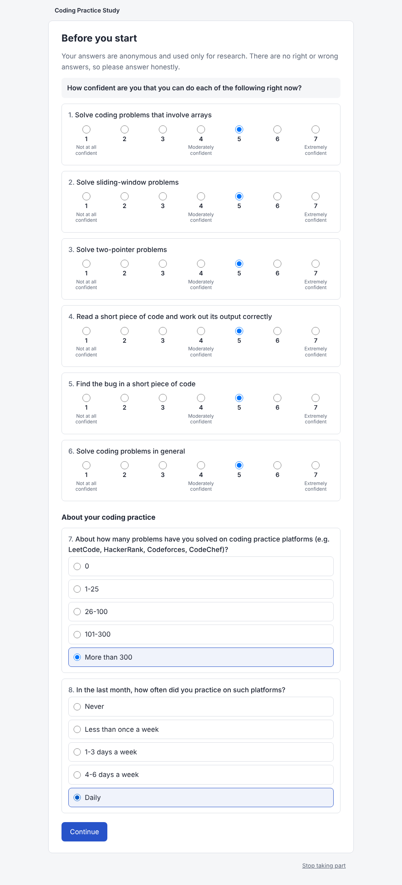
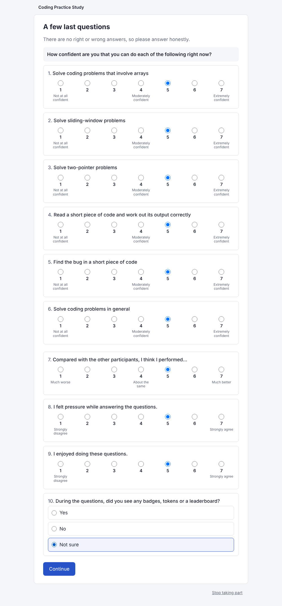

# Confidence Quest

A small web app for one controlled experiment: **does gamification change students'
confidence on a coding test?** Participants are randomly split into a Control and an
Experimental group. Both answer the same nine questions with right/wrong feedback. The
Experimental group plays it as a game: a live game bar, an animated result card after
every answer, tokens, streaks, levels, badges, live ranking and a leaderboard.
Confidence (C1-C6) is measured before and after for the planned ANCOVA.

Built to the implementation brief: Node + Express, no build step, the server is the source of
truth, all content in JSON, the answer key never leaves the server. Data goes to a **cloud
Postgres database** when hosted (free: Neon) and to a **local SQLite file** on your own computer.

**To put it online for free, follow [`docs/hosting.md`](docs/hosting.md)** (Vercel + Neon, about 20 minutes).

| Correct answer (Experimental) | Wrong answer (Experimental) |
|---|---|
|  |  |

## Run it

```bash
cd confidence-quest
npm install
ADMIN_TOKEN=pick-a-long-secret npm start        # http://localhost:3000
```

- Participants open `http://localhost:3000/`.
- The researcher opens `http://localhost:3000/admin` and enters the `ADMIN_TOKEN`.
- Without `DATABASE_URL`, data goes to `data/app.sqlite` (built on first start).
  With `DATABASE_URL` (a Postgres connection string), the same tables are built in that database.
- The server **refuses to start** if a content file is missing or invalid and prints the file and field,
  and refuses to start on Vercel or Render without `DATABASE_URL` (their disks are wiped on restart).

All settings are environment variables (see `.env.example`): `DATABASE_URL`, `ADMIN_TOKEN`,
`ALLOCATION_SEED`, `NODE_ENV`, `PORT`, `DB_PATH`, plus `STUDY_MODE` and `SECURE_COOKIES`.

## Commands

| Command | What it does |
|---|---|
| `npm start` | Start the server |
| `npm test` | Unit + integration tests (Vitest + Supertest) on SQLite |
| `TEST_DATABASE_URL=postgres://... npm test` | The same tests against a Postgres database (each test gets its own schema) |
| `npm run test:e2e` | Playwright: a Control and an Experimental participant play through in a real browser; CSVs checked |
| `npm run screenshots` | Same, and saves screenshots to `docs/screenshots/` (including a busy session with a full leaderboard) |
| `npm run check:content` | Validate content files and compare the questions with Appendix A |
| `npm run allocation` | Create/print the allocation list (`-- --simulate 1000 --n 50` for a balance check, `-- --preview --seed X`) |
| `npm run backup -- before-session-1` | Backup into `data/backups/` (SQLite file copy, or every table as JSON for Postgres) |
| `npm run export` | All CSVs + data dictionary + content files and hashes into `data/exports/<time>/` (`-- --pilot` for pilot rows only) |
| `python3 scripts/analysis/verify_exports.py <dir> [status.json]` | Reload the CSVs and reproduce the app's status counts |
| `python3 scripts/analysis/ancova.py <dir>/participants.csv` | Alpha for C1-C6, the ANCOVA, manipulation check, Q11/Q13/Q14 and baseline balance (`ancova.R` does the same in R) |

## The participant journey

```
Consent → Pre-test (C1-C6, P1-P2) → (group assigned) → Instructions
   → Question n of 9 → Correct/Incorrect (+ game card for Experimental) → … ×9
   → Score reveal: "You answered X of 9 correctly." (same for both; + tokens, badges, rank for Experimental)
   → Post-test: C1-C6 again (identical), Q11, Q13, Q14, then Q12 last
   → Debrief + participant code
```

The server stores the step, so a refresh or a closed tab resumes exactly there. Double
clicks and network retries are ignored (idempotency keys, unique constraints).
"Stop taking part" is available on every step until the debrief.

| Screen | Control | Experimental |
|---|---|---|
| Question |  |  |
| After an answer |  |  |
| Score reveal |  |  |

| Pre-test | Post-test |
|---|---|
|  |  |

### The game layer (Experimental group only)

- **Game bar on every question:** tokens, streak flame, level bar, badges x/8, and a right/wrong dot per answered question.
- **Animated result card after every answer**, plain white over the dimmed page. Correct: a check that draws itself, streak titles that escalate ("Double up!" → "On fire!" → "Unstoppable!"), +tokens and streak bonus, level-up banner, badge unlocks, light confetti. Wrong: a cross, "streak lost", encouragement, a small shake.
- **Tokens** 1/2/3 by difficulty + a streak bonus; **5 levels** (Rookie → Legend); **8 badges** (3 for effort, 5 for performance).
- **Live rank** while answering, against real players who already answered that question.
- **Results reveal:** trophy, count-up tiles, badge collection, rank, animated leaderboard; confetti for the top half.

The Control group sees none of it. All rules and texts live in `server/content/gamification.json`;
details and the design trade-off are in [`docs/decision_register.md`](docs/decision_register.md).
Sound effects exist but are off (in a shared room they would reveal who is in which group).

## Changing the study (no code changes)

Everything the team still has to decide is a content edit in `server/content/`:

| File | Holds |
|---|---|
| `questions.json` + `answer_key.json` | The nine questions, verbatim from Appendix A (`source/appendix_a_final_test.md`). A test fails if they drift. |
| `survey.json` | The final questionnaires: items, scales, and the order of each survey (pre, post) |
| `gamification.json` | Tokens, badges, leaderboard, rank rules |
| `study.json` | Consent, instructions, debrief texts; time limit; "I don't know"; question order; allocation settings |

**What runs today and where each open decision lives: [`docs/decision_register.md`](docs/decision_register.md).**
Placeholder texts are flagged on start-up and on the status page until each file is marked `"status": "approved"`.

After editing content: `npm run check:content && npm test`.

## Research data

- One random session token per participant, stored only as a hash. No names, emails, student IDs, IPs or user agents, anywhere.
- Random assignment from a pre-generated, seeded allocation list (permuted blocks), claimed atomically when the pre-survey is submitted (on Postgres with `FOR UPDATE SKIP LOCKED`, so two people at the same instant never share a slot). Abandoned slots are never reused. The seed and full list are exported.
- Where the data lives, and how to see it: [`docs/hosting.md`](docs/hosting.md#where-the-data-is-stored).
- Pilot/rehearsal participants (status page → PILOT mode) carry `is_pilot = 1` and never appear in research exports.
- Exports and every column: [`docs/data_dictionary.md`](docs/data_dictionary.md).

## Deploy

**Free: Vercel (runs the `Dockerfile`) + Neon (Postgres database).** Step by step, with
screens to click and what to type: [`docs/hosting.md`](docs/hosting.md). Render works too (same guide).

Any host that runs Node 22 or 24 works the same way: build `npm ci`, start `npm start`, and set
`DATABASE_URL`, `ADMIN_TOKEN`, `ALLOCATION_SEED`, `NODE_ENV=production`. Any Docker host can use
the `Dockerfile` (it listens on port 80 and needs `DATABASE_URL`). The app logs no IP addresses; the host's own request logs may (D15).

### Laptop fallback (no internet)

Run it on one laptop on the room's network; data stays in `data/app.sqlite` on that laptop:

```bash
NODE_ENV=production SECURE_COOKIES=0 ADMIN_TOKEN=... ALLOCATION_SEED=... npm start
# participants open http://<laptop-ip>:3000
```

`SECURE_COOKIES=0` is needed because the LAN link is plain http.

Before the day: code freeze 48 h before, full rehearsal in PILOT mode then **Delete pilot data**,
backups before and after every session. Step by step: [`docs/experiment_day_runbook.md`](docs/experiment_day_runbook.md).

## API

| Method | Path | Purpose |
|---|---|---|
| GET | `/api/texts` | Consent and UI text (public) |
| POST | `/api/session` | `{consent: true}` creates the participant and sets the cookie |
| GET | `/api/state` | Current step and question number (never the arm). `{step: "CONSENT"}` before consent |
| GET / POST | `/api/survey/:phase` | `pre` or `post`: sections and items; submit all answers (pre also assigns the group) |
| POST | `/api/instructions/ack` | Instructions → Q1 |
| GET | `/api/question/:n` | Only the current question; sets `shown_at` the first time |
| POST | `/api/answer` | `{questionId, selectedOption, idempotencyKey}` → `{correct, next, game?}` |
| POST | `/api/next` | `{n}` feedback → next question, or the score after Q9 |
| GET | `/api/results` | The score reveal (only after Q9) |
| POST | `/api/results/ack` | Score reveal → post-test |
| POST | `/api/complete` | Debrief and participant code (repeatable) |
| POST | `/api/withdraw` | `{confirm: true}` stop taking part |
| GET | `/healthz` | Uptime check (also says `sqlite` or `postgres`) |
| GET | `/admin/api/status` | Counts by arm and step (header `X-Admin-Token`) |
| GET | `/admin/api/export/:name.csv` | `participants`, `questions`, `surveys`, `events`, `gamification`, `allocation`, `meta` (`?cohort=pilot` for pilot rows) |
| GET | `/admin/api/backup.json` | Every table as one JSON file (works on both databases) |
| POST | `/admin/api/backup` | SQLite only: copy the database file on the server |
| POST | `/admin/api/mode` | `{mode: "pilot" \| "live"}` |
| POST | `/admin/api/purge-pilot` | `{confirm: "DELETE PILOT DATA"}` |
| POST | `/admin/api/withdraw` | `{participant_code, confirm: true}` remove one participant's answers |

Errors: `{error: {code, message}}` with `VALIDATION` 400, `NO_SESSION` 401, `FORBIDDEN` 403,
`NOT_FOUND` 404, `NOT_YOUR_TURN` 409, `SERVER` 500. Every error is logged to `events` with a
code only, never participant text.

## Folder structure

```
server/   index.js · bootstrap.js · app.js · config.js
          db/ (connection.js: SQLite or Postgres, schema.sqlite.sql, schema.postgres.sql, migrate.js)
          content/ (questions, answer_key, survey, gamification, study + source/appendix)
          routes/ (session, survey, questions, results, admin)
          services/ (stateMachine, assignment, scoring, surveyScoring, gamification, exporter, content, maintenance)
          middleware/ (auth, errors, validate)
public/   index.html · admin.html · css/ · js/ (app, api, dom, admin, screens/)
scripts/  generate_allocation · check_content · backup · export_all · analysis/
tests/    unit/ · integration/ · e2e/
docs/     hosting · decision_register · data_dictionary · experiment_day_runbook · screenshots/
data/     (gitignored) app.sqlite, backups/, exports/
```
